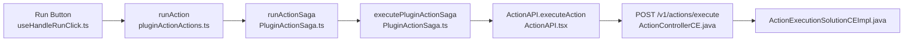
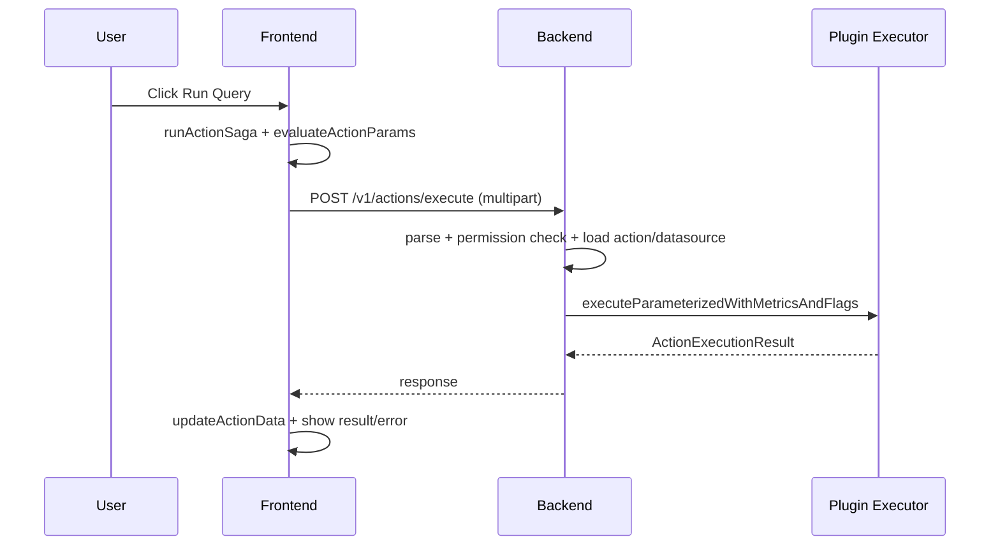

# Run Query (Action Execution)

## 1) Where the feature is located

## 2) How the feature works

## Appendix: AI Assistance Details (For This Assignment)

1. Consulted the AI ​​to identify the actual entry point and primary execution path for `Run Query (Action Execution)` within the project codebase, followed by manual verification.
2. Consulted the AI ​​to map out the execution path from the frontend to the backend, followed by manual verification.

