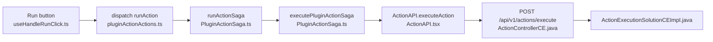
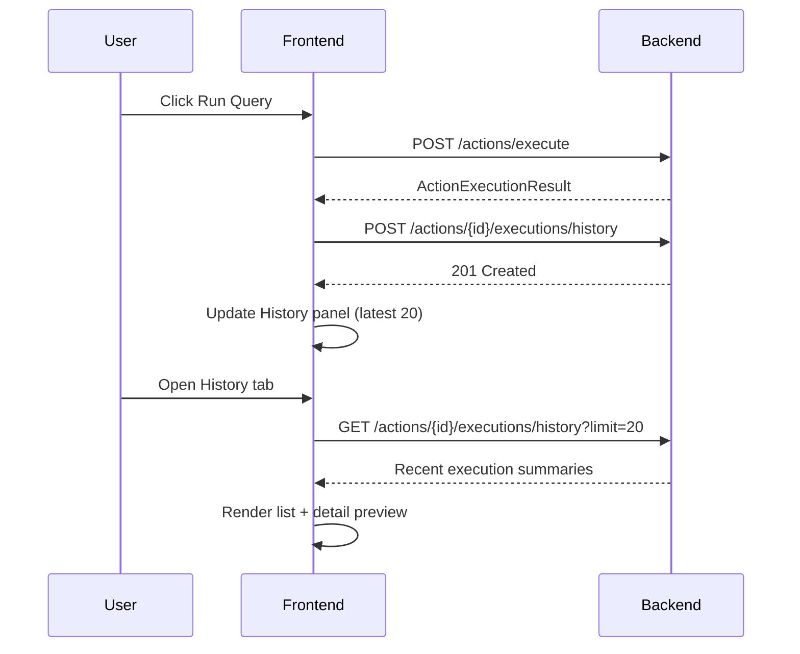

## 1) Brief Description of the New Feature

### Feature name
**Query Execution History**

### What it does
This feature adds a lightweight history panel for each action/query in the editor. Every time a user clicks **Run**, the system records a compact execution record and shows recent runs (latest 20) with:
- timestamp
- execution status (success/failure/cancelled)
- duration (ms)
- environment name
- small request/response preview (truncated)

Users can quickly inspect recent failures and compare current behavior with previous runs without re-running blindly.

## 2) Motivation and Value

Current behavior already supports running actions and showing the latest response in the debugger tab, but previous runs are not preserved in a query-specific timeline. This causes friction when:
- debugging intermittent errors,
- comparing parameter changes across attempts,
- explaining failures during team collaboration.

Why this is valuable:
- improves developer productivity during troubleshooting,
- reduces repeated runs on external services,
- provides better local observability while staying inside existing editor workflows.

## 3) Relevant Current System Aspects

The current run-query flow in this codebase:

Important existing implementation details:
- Frontend run trigger is in `app/client/src/ce/PluginActionEditor/hooks/useHandleRunClick.ts`.
- Main execution orchestration is in `app/client/src/sagas/ActionExecution/PluginActionSaga.ts` (`runActionSaga`, `executePluginActionSaga`).
- API call is `ActionAPI.executeAction(...)` in `app/client/src/api/ActionAPI.tsx` posting multipart form data to `/actions/execute`.
- Backend execute endpoint is in `app/server/appsmith-server/src/main/java/com/appsmith/server/controllers/ce/ActionControllerCE.java`.
- Backend execution pipeline is coordinated by `app/server/appsmith-server/src/main/java/com/appsmith/server/solutions/ce/ActionExecutionSolutionCEImpl.java`.

## 4) Detailed Design

### 4.1 High-level design

Add a **new editor-side history panel** and a **small backend persistence API** for recent run records.

### 4.2 Data model

Add a new entity/table: `ActionExecutionHistory`
- `id` (string)
- `actionId` (string, indexed)
- `applicationId` (string, indexed)
- `workspaceId` (string)
- `branchName` (string, nullable)
- `triggeredByUserId` (string)
- `status` (`SUCCESS` | `FAILURE` | `CANCELLED`)
- `durationMs` (long)
- `environmentId` (string)
- `requestPreview` (string, max length e.g. 2000)
- `responsePreview` (string, max length e.g. 4000)
- `createdAt` (timestamp, indexed desc)

Retention policy:
- keep latest **200** records per action (older rows pruned asynchronously).

### 4.3 Backend changes

1. Add endpoints under action controller layer:
- `POST /api/v1/actions/{actionId}/executions/history`
- `GET /api/v1/actions/{actionId}/executions/history?limit=20`

2. Add service/repository for save/query of history records.

3. Access control:
- Only users with action edit/execute permissions can read/write corresponding history.
- Reuse existing permission patterns from action execution solution path.

4. Safety:
- Redact sensitive fields before storing preview (`password`, `token`, `authorization`, etc.).
- Truncate payload previews to bounded size.

### 4.4 Frontend changes

1. Extend `executePluginActionSaga` success/failure/cancel paths to dispatch a new action:
- `recordActionExecutionHistoryRequest(...)`

2. Add a new saga to call history POST endpoint in background (non-blocking; run result UX must not wait on this).

3. Add a **History** tab in Plugin Action Response area:
- default list view (timestamp, status, duration),
- click row to show compact request/response detail.

4. State management:
- add `actionExecutionHistory` slice keyed by `actionId`.
- fetch on tab open and refresh after new run completion.

### 4.5 Fit with current codebase

This feature is intentionally modular:
- It does **not** change the existing `/actions/execute` contract.
- It hooks into already centralized execution points (`runActionSaga`/`executePluginActionSaga`), minimizing invasive edits.
- It follows current frontend architecture: redux action + saga + API layer + editor UI tab.
- It follows current backend layering: controller -> solution/service -> persistence.

### 4.6 Testing plan

Backend:
- unit tests for redaction/truncation logic,
- repository tests for pagination and per-action retention,
- permission tests for authorized/unauthorized users.

Frontend:
- saga tests verifying history record dispatch on success/failure/cancel,
- reducer tests for list update behavior,
- component tests for history list rendering and detail panel.

E2E:
- run a query twice, verify two entries appear in history,
- force one failed run and verify status + preview.

## 5) Limitations

- History is editor-focused and does not initially appear in published app runtime.
- Stored previews are intentionally truncated; not full payload archives.
- If backend history save fails, query execution still succeeds (best-effort logging).
- Cross-action/global search in history is out of scope for this iteration.

## 6) Appendix: Intermediate Artifacts

### A1 - Feature Option Comparison

## Candidate options

1. Query Execution History
- Pros: high debugging value, clear fit with existing run flow, moderate complexity.
- Cons: needs small persistence model and redaction logic.

2. Destructive Query Guardrails
- Pros: safety-focused, easy to explain.
- Cons: overlap with existing confirmation behavior in some action types.

3. Auto-Retry on transient errors
- Pros: reliability improvement.
- Cons: higher correctness risk (idempotency), harder to make universally safe.

## Selected option

**Query Execution History** was selected because it is meaningful, non-trivial, and safest to integrate without altering core execution contract.

### A2 - Architecture Sketch

## Initial sketch (v1)

Run Query -> Execute API -> Update latest response only

Issue found: no persistent timeline for previous attempts.

## Revised sketch (v2)

Run Query -> Execute API -> Record summary asynchronously -> History tab fetches latest N records

Design decision:
- keep recording async so execution UX is not blocked,
- store only compact preview with redaction and truncation,
- keep strict retention cap per action.

### A3 - Discussion Log (Summarized)

## Topics discussed

- Should history be frontend-only local state or backend persisted?
- Should we store full payloads or previews?
- Should this run in published mode?

## Decisions

- Use backend persistence for team visibility and durability.
- Store redacted, truncated previews (security + storage control).
- Scope first version to editor mode; published-mode integration can be phase 2.

## Open questions

- Exact retention number (chosen proposal: 200 per action).
- Whether to add filters (status/date) in phase 1 (currently no).